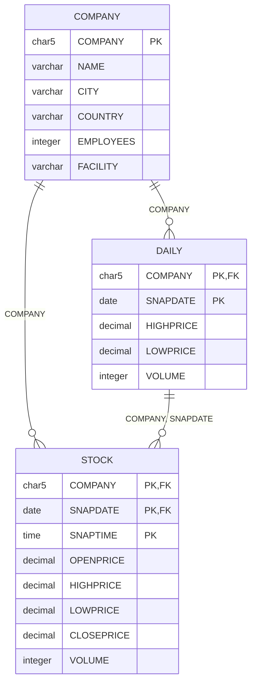

# IEG Holding: Intraday Stock Database (IBM DB2)

**Relational database for 15-minute stock data of three companies: schema design, data-quality checks, daily aggregation and cascading referential integrity.**

572 intraday snapshots (3 companies, 10-14 Aug 2022) loaded into IBM DB2, summarised into a daily table, linked to company master data, and stress-tested with deletes that cascade across all three tables.

## Schema



## What it does

| Step | SQL technique | Result |
|---|---|---|
| Load and validate | `CREATE TABLE`, composite PK, aggregate check query | 186 / 194 / 192 rows; no duplicate periods |
| Data-quality report | Pivot with `MAX(CASE ...)`, `HAVING COUNT(DISTINCT) < 3` | 17 periods on 11 Aug where at least one company is missing |
| Price direction | Conditional `SUM(CASE ...)` | IEG01 closed up 93 times, down 58, flat 28 |
| Daily summary | `INSERT ... SELECT` with `GROUP BY` | 15 rows (3 companies x 5 days) |
| Master data | Nullable design: every fact in the case gets a column | 3 companies, Madrid, Hartford, Shanghai |
| Integrity | 3 foreign keys with `ON DELETE CASCADE` | Delete a company or a day, dependents go with it |
| Side-effect audit | `UNION ALL` row-count check after each delete | IEG03 STOCK rows: 192 > 189 > 151 > 117 > 0 |

Two details that matter:
- **NULL logic.** Open-vs-close counts do not add up to the row count (IEG01: 179 of 186). Rows with a NULL price compare as UNKNOWN and land in no bucket.
- **Two cascade paths.** STOCK references both COMPANY and DAILY. DB2 accepts the double path because both use `CASCADE`, and each key maps one-to-one to a business rule.

## Files

```
sql/ieg_holding_db2.sql    full solution, Q1 to Q9, commented
data/IEG01-03.csv          raw 15-minute snapshots
tests/verify_sqlite.py     re-runs the script on SQLite and asserts every result above
```

Run the check (no DB2 needed):

```bash
python3 tests/verify_sqlite.py
# All checks passed: Q2 counts, Q3 17 rows, Q4 counts, Q6 15 rows, Q9 cascade 192 > 189 > 151 > 117 > 0
```

## Team

Group assignment, SQL Based Data Architectures I, Master in Business Analytics and Data Science, IE School of Science & Technology, October 2026. Built with Quique, Armaan and Aseal. I consolidated the four individual proposals into the final answer, choosing per question on data types, key design and documentation. Company data is fictional, from the case.

Tools: IBM DB2 · DBeaver · SQL · Python (sqlite3 for the test)
